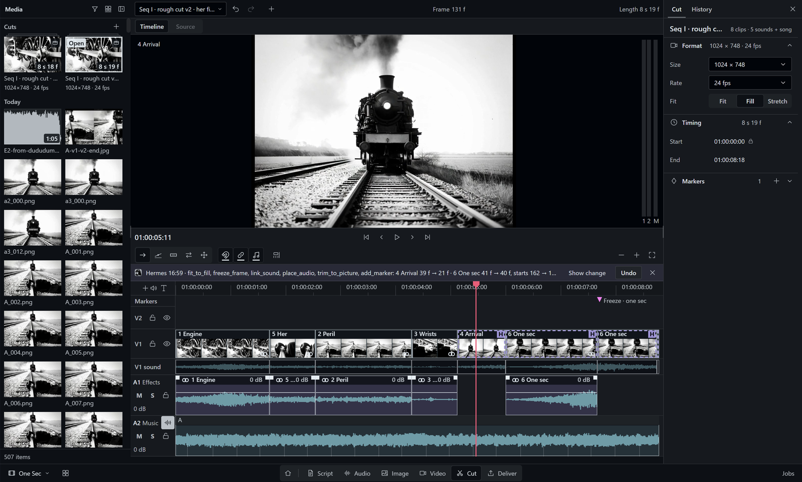
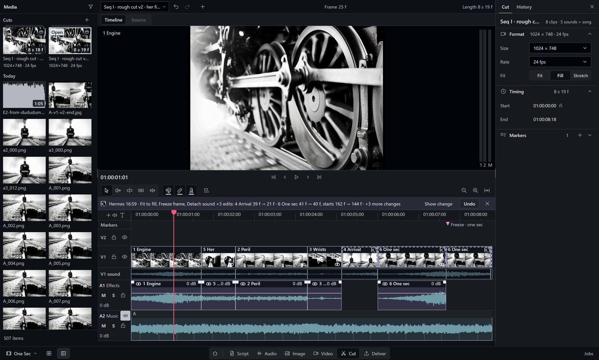
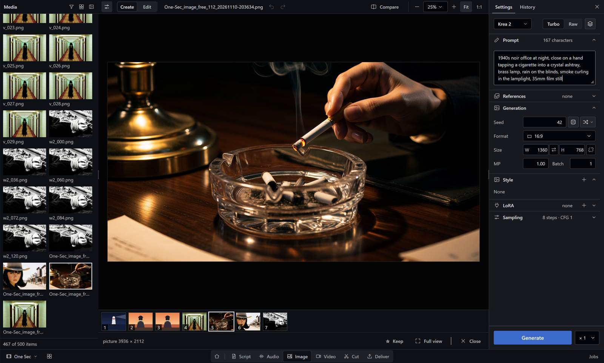
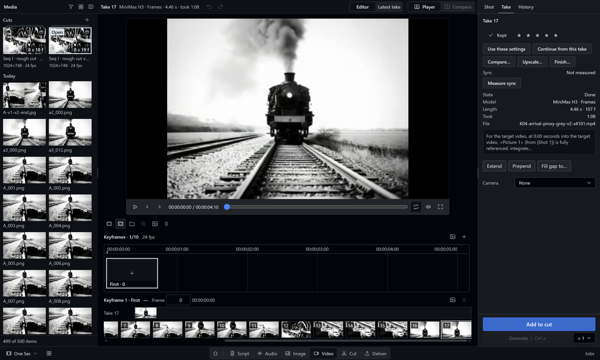
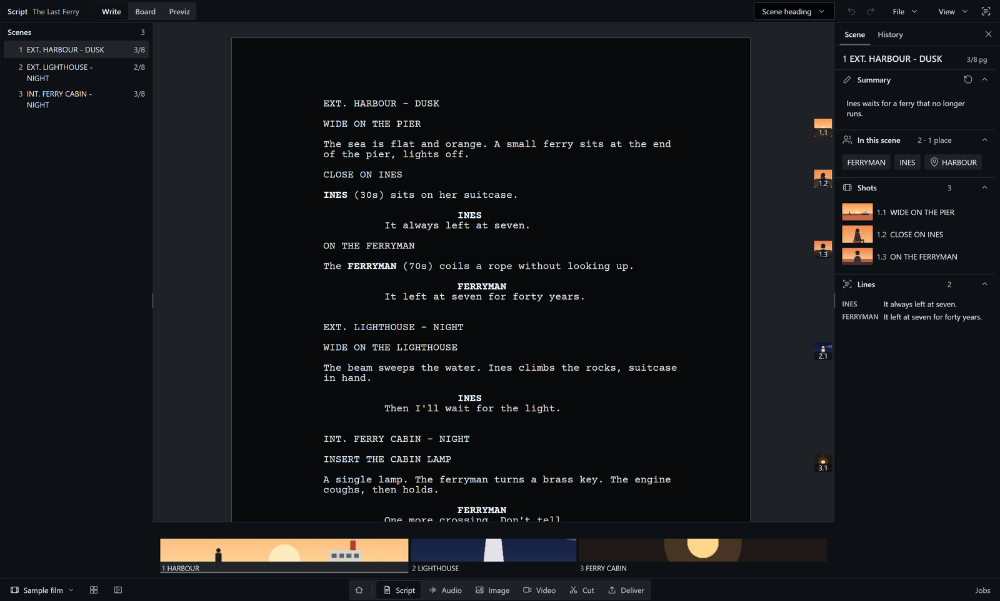
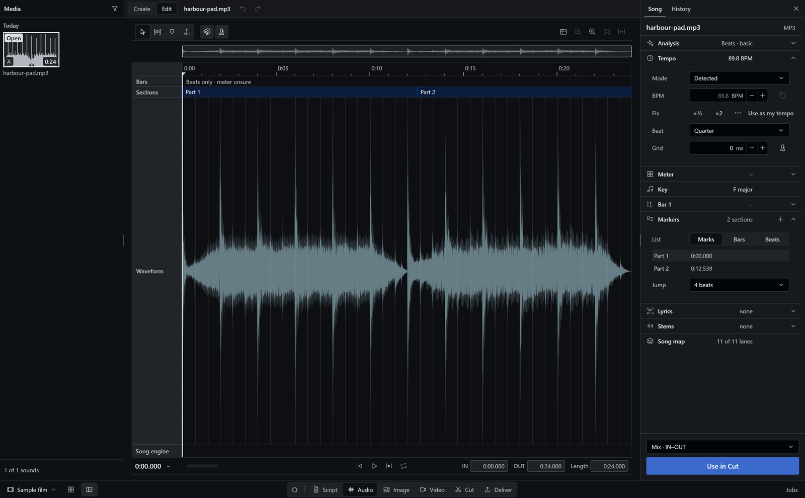
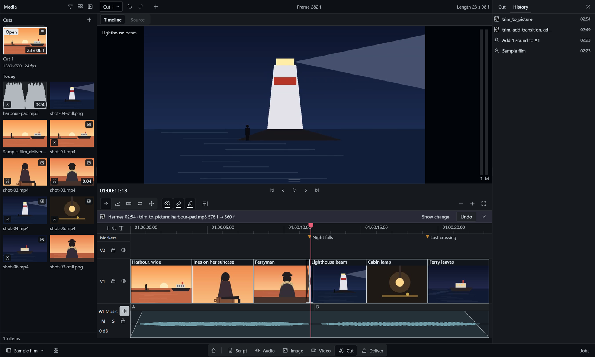

# Continuo

**A film studio inside Hermes.** You write the script, make pictures and video takes on your own GPU, cut them to
music and render the film. Hermes works in the same project, on the page you have open.



**Start without any model.** Open the Sample film, change the cut and render an MP4. Only ffmpeg is needed for that.
Script, Cut, beat analysis and Deliver run on the CPU.

**You and Hermes work on the same film.** Hermes gets 209 tools that cover every page, and the open page shows
what Hermes did. On Script and Cut you can undo each of its changes. Only you can approve a folder for Continuo.

```
hermes plugins install https://github.com/realartsbro/continuo
hermes plugins enable film-suite
```

Then restart Hermes, open **Capabilities > Plugins** and turn the **Continuo** switch on. Continuo appears in the
sidebar at once. Details are under [Install](#install).

Continuo is a plugin for [Hermes Agent](https://hermes-agent.nousresearch.com), the open-source AI agent by Nous
Research. It needs Hermes Agent `>=0.22.7` with the desktop app. MIT licence.

[Pages](#cut-and-deliver) ·
[Install](#install) ·
[Models](#models-optional) ·
[Talk to Hermes](#talk-to-hermes) ·
[What it does on your machine](#what-this-plugin-does-on-your-machine)

## Cut and deliver



One timeline with picture tracks, sound tracks and a music lane. Continuo finds the beats of the song, and
**Fit to beats** moves the cuts onto them. With the optional speech detector (Silero VAD), the music drops under
dialogue by itself.

**Deliver** renders an MP4 or a film master (Apple ProRes in a MOV), with SRT and VTT subtitles. It also writes the
timeline as FCPXML 1.9, FCP 7 XML, OpenTimelineIO and EDL, the exchange formats of Premiere, Resolve and Final Cut.
**Check before render** stops a render while a clip is offline. The render queue keeps its jobs across a restart.

## Image



**Create** pictures from a prompt with a local model through ComfyUI, then **Edit** a selection or a mask. Each picture
keeps the prompt, seed and settings that made it; **Use these settings** puts them back into the controls.

## Video



Make video takes with MiniMax H3 on your own GPU, from a prompt, from keyframes or from reference pictures. Continue
a take from a frame you choose, compare two takes A/B, upscale the one you keep and send it to Cut.

## Script



Write in screenplay format with a scene list. Enter and Tab pick the next element; `int.` or `ext.` starts a scene
heading. Hermes writes in the same script, and you can undo what it changed.

## Audio



Play a song, set IN and OUT and analyse it. The built-in analysis finds beats, bars and the song's sections; the
optional song engine names them (Intro, Verse, Chorus). **Use in Cut** places the song or the IN-OUT range under the
cut.

## Hermes works beside you



Hermes uses the same project and the same job list as you. When it rewrites a scene or moves a clip, the open page
shows the change with before and after, and Undo takes it back. Each edit from Hermes names the revision it read. If
you changed the scene or the cut since then, the edit is refused and nothing is saved.

## Install

### Requirements

| Part | Requirement | Notes |
|:---|:---|:---|
| Platform | Windows 11 | Tested on Windows 11. The code is written to run on Linux too, not yet tested; reports are welcome, see [Feedback](#feedback). macOS is on the roadmap. |
| Hermes&nbsp;Agent | `>=0.22.7` | With the Hermes desktop app. |
| ffmpeg | Required | For Cut, Deliver and Audio; tested with 7.1.1. Looked up in `FFMPEG_PATH`, then `PATH`, then `C:\ffmpeg\bin`. |
| ComfyUI | For generation | Generates pictures, video, music and voice on your machine: Continuo asks `http://127.0.0.1:8188`, then `http://127.0.0.1:8000` (the ComfyUI desktop app). Another address: set `FILM_SUITE_COMFY_URL` (for example `http://127.0.0.1:8189`). |
| GPU | For generation | Script, Cut, Audio analysis and Deliver run on the CPU, so a GPU is optional for them. Generation uses your GPU. |
| Disk | 22&nbsp;MB&nbsp;+&nbsp;511&nbsp;MB | Measured: the plugin 22 MB; its Python packages 511 MB, set up by Hermes. Models need extra space, see [Models](#models-optional). |

### Steps

```
hermes plugins install https://github.com/realartsbro/continuo
hermes plugins enable film-suite
```

No GitHub login is needed. The plugin's id in Hermes is `film-suite`; Continuo is its name in the app.

> **The install scan says "caution".** Hermes scans every plugin before it installs it. Continuo runs ffmpeg and talks
> to your local ComfyUI (`127.0.0.1`), so the scan asks you to confirm. Answer `y`. The reasons are listed under
> [Install scan](#install-scan). The installer then asks whether to enable the plugin and whether to set up its Python
> packages (numpy, librosa, soundfile, httpx, Pillow; 511 MB). Answer `y` to both.

1. Restart Hermes.
2. Open **Capabilities > Plugins**, find **Continuo** and turn its switch on. Continuo appears in the sidebar at once.
   Hermes installs a plugin's window switched off, and `hermes plugins enable` turns on only the agent's tools. A
   restart does not turn the window on.
3. Open **Continuo** from the sidebar. Hermes also gets three skills: `film-suite:continuo` (which tool does what),
   `film-suite:video-prompts` and `film-suite:image-prompts` (how to prompt the video and image models).

### Your first film, no models needed

The Sample film needs only ffmpeg. It holds three scenes, six pictures, music with a steady beat and a cut. The six
pictures are AI-generated with Krea 2 Turbo; the script and the music are CC0 (free to reuse).

1. On **Start**, choose **Sample film**. Continuo copies it into a new project folder,
   `Documents\Continuo\Sample film`, and opens it on **Cut**.
2. Play the cut. Move or trim a clip.
3. Open **Deliver**, choose the format **MP4** and click **Add to render queue**.
4. The file is saved to the project's output folder: `output/` inside the project folder, unless you chose another
   folder in the project settings.

Or ask Hermes in one sentence:

```text
Open the sample film in Continuo, swap the first two shots and export an MP4.
```

## All pages

The bar at the bottom of Continuo holds the pages in working order.

| Page | What you can do |
|:---|:---|
| **Script** | Write in screenplay format with a scene list; Hermes writes in the same script, and you can undo its changes. |
| **Audio** | Play a song, set IN and OUT, analyse beats and song parts, and **Use in Cut**. |
| **Image** | **Create** pictures from a prompt and **Edit** a selection or mask; **Use these settings** restores any result. |
| **Video** | Make MiniMax H3 takes locally, continue a take, compare A/B, upscale and send to **Cut**. |
| **Cut** | Edit one timeline with music, song parts and beats; **Fit to beats**, and music lowered under dialogue with the speech detector. |
| **Deliver** | Render MP4 or Film master, export FCPXML, FCP 7 XML, OTIO, EDL and subtitles, after **Check before render**. |
| **Media** | Browse the project's media on every page, with bins, filters, ratings and compare. |
| **Jobs** | See and stop every running job in one list, the same list Hermes works with. |

**More on each page**

<details>
<summary>Show</summary>

- **Script**: Enter and Tab pick the next element, `int.` or `ext.` starts a scene heading, Fountain bold and italic
  show while you type. Hermes' changes are marked.
- **Audio**: waveform, playback, IN and OUT, markers. Analysis runs only when you ask: beats, bars and sections with
  the built-in engine, named song parts (Intro, Verse, Chorus) with the optional song engine. Lyrics are transcribed from the vocals
  or taken from text you paste. **Use in Cut** places the whole song or the IN-OUT range.
- **Image**: several pictures in one run with a local model. Edit with selection tools, numbered boxes and **Remove**.
  Every picture keeps the prompt and settings that made it.
- **Video**: takes from keyframes or reference pictures, run on your machine. Continue a take from a chosen frame, keep
  the best one.
- **Cut**: a large viewer (Timeline and Source), tracks V1, V2, A1 to A3 and Music. Clips come from your folders
  through Source IN/OUT. Each cut of the project is its own item in **Media**.
- **Deliver**: MP4, Film master (MOV, Apple ProRes), FCPXML 1.9, FCP 7 XML, OpenTimelineIO, EDL (CMX 3600), SRT and
  VTT. **Check before render** refuses offline clips; the render queue can stop and re-render, and it survives a
  restart.
- **Jobs**: all jobs from every page that run in the background, with stop. Hermes can also repeat them.

</details>

## Models (optional)

No model ships with Continuo, and the Sample film needs none.

- **Without any model**: Script, Cut, Deliver, Media and Jobs, plus Audio playback, IN and OUT, markers, beat analysis
  with the built-in librosa engine, and **Use in Cut**.
- **With ComfyUI and models**: Image **Create** and **Edit**, Video takes and upscaling, stems and music generation.
  Voice and song generation are in progress.

Each generation feature runs a ComfyUI workflow. Install only the models of the workflows you want to use:

| Page | Workflows | Size per workflow |
|:---|---:|---:|
| **Image › Create** | 9 | 5.6–31.2 GB |
| **Image › Edit** | 9 | 11.0–31.2 GB |
| **Video** | 8 | 4.5–45.6 GB |
| **Audio** (5 in progress) | 7 | 0.5–40.1 GB |

**All workflows and model sizes**

<details>
<summary>Show the table</summary>

Sizes come from the plugin's own source list (`dashboard/workflows/model-sources.json`); files shared between
workflows count once per row. Rows marked "in progress" are wired but not yet proven in the app. Repos are on Hugging
Face, custom nodes on GitHub.

| Workflow | For | Size | Files | Hugging Face repos, custom nodes |
|:---|:---|:---|:---|:---|
| yue2-song-v1 | Audio: a song with lyrics (in progress) | 3.96 GB | 1 | Comfy-Org/YuE2 |
| omnivoice-design-v1 | Audio: a voice from a description (in progress) | 2.45 GB | 1 | Bgeorge/OmniVoice; Nodes: Saganaki22/ComfyUI-OmniVoice-TTS |
| drama3-clone-v1 | Audio: a voice from a reference recording (in progress) | 40.14 GB | 2 | PedroMarinhoDev/Drama-3-ComfyUI; Nodes: PedroMarinhoDev/ComfyUI-Drama3 |
| omnivoice-clone-v1 | Audio: a voice from a reference recording (in progress) | 2.45 GB | 1 | Bgeorge/OmniVoice; Nodes: Saganaki22/ComfyUI-OmniVoice-TTS |
| foundation1-loop-v1 | Audio: loops and keybeds (in progress) | 5.75 GB | 3 | RoyalCities/Foundation-1; google-t5/t5-base |
| sa3-small-music-v1 | Audio: music from a prompt (Stable Audio 3 Small) | 3.46 GB | 2 | Comfy-Org/stable-audio-3 |
| audio-stems-v1 | Audio: split a song into stems | 0.46 GB | 1 | Kijai/MelBandRoFormer_comfy |
| flux3-klein-sd-create-v1 | Image › Create | 20.77 GB | 4 | Comfy-Org/Flux-2-Dev; Comfy-Org/Krea-2; KoalaNation/FLUX-3-KLEIN-MODELS; black-forest-labs/flux-3-image-klein-comfy |
| anima-turbo-create-v1 | Image › Create (Anima Turbo) | 5.63 GB | 3 | Comfy-Org/Qwen-Image; circlestone-labs/Anima |
| flux2-klein-9b-t2i-v1 | Image › Create (FLUX.2 Klein 9B) | 18.82 GB | 3 | Comfy-Org/Flux-2-Dev; Comfy-Org/Flux-2-Klein-9B; black-forest-labs/FLUX.2-klein-9b-kv-fp8 |
| ideogram4-create-v1 | Image › Create (Ideogram 4) | 30.09 GB | 4 | Comfy-Org/Flux-2-Dev; Comfy-Org/Ideogram-4; Comfy-Org/Qwen3-VL |
| krea2-raw-t2i-create | Image › Create (Krea 2 Raw) | 18.99 GB | 3 | Comfy-Org/Krea-2; Comfy-Org/Qwen-Image; Comfy-Org/Qwen3-VL |
| krea2-turbo-t2i-create | Image › Create (Krea 2 Turbo) | 18.99 GB | 3 | Comfy-Org/Krea-2; Comfy-Org/Qwen-Image; Comfy-Org/Qwen3-VL |
| moss-image-sft-create-v1 | Image › Create (MOSS-Image) | 20.25 GB | 3 | Comfy-Org/Flux-2-Dev; Comfy-Org/MOSS-Image |
| p-h3-image-lora-t2i-v1 | Image › Create (P-H3-Image) | 31.19 GB | 4 | Comfy-Org/MiniMax-H3; PrunaAI/P-H3-Image-Comfy |
| qwen-image-2.1-create-pe-v3-v2 | Image › Create (Qwen-Image 2.1) | 27.09 GB | 5 | Comfy-Org/Qwen-Image-2.1; Comfy-Org/Qwen3-VL; PrunaAI/Pruna-Q-Image-2.1 |
| flux3-klein-sd-edit-v1 | Image › Edit | 20.77 GB | 4 | Comfy-Org/Flux-2-Dev; Comfy-Org/Krea-2; KoalaNation/FLUX-3-KLEIN-MODELS; black-forest-labs/flux-3-image-klein-comfy |
| flux2-klein-9b-kv-edit-v1 | Image › Edit (FLUX.2 Klein 9B) | 18.82 GB | 3 | Comfy-Org/Flux-2-Dev; Comfy-Org/Flux-2-Klein-9B; black-forest-labs/FLUX.2-klein-9b-kv-fp8 |
| krea2-edit-turbo-v1 | Image › Edit (Krea 2 Turbo) | 20.82 GB | 4 | Comfy-Org/Krea-2; Comfy-Org/Qwen-Image; Comfy-Org/Qwen3-VL; conradlocke/krea2-identity-edit |
| krea2-general-edit-v2 | Image › Edit (Krea 2 with the general edit LoRA) | 20.82 GB | 4 | Comfy-Org/Krea-2; Comfy-Org/Qwen-Image; Comfy-Org/Qwen3-VL; conradlocke/krea2-identity-edit |
| krea2-edit-kroma-v1 | Image › Edit (Krea 2, Kroma) | 21.46 GB | 4 | Comfy-Org/Qwen-Image; Comfy-Org/Qwen3-VL; conradlocke/krea2-identity-edit; silveroxides/Kroma-Quant |
| p-h3-image-lora-edit-v1 | Image › Edit (P-H3-Image) | 31.19 GB | 4 | Comfy-Org/MiniMax-H3; PrunaAI/P-H3-Image-Comfy |
| qwen-image-2.1-edit-pe-v3-v2 | Image › Edit (Qwen-Image 2.1) | 27.09 GB | 5 | Comfy-Org/Qwen-Image-2.1; Comfy-Org/Qwen3-VL; PrunaAI/Pruna-Q-Image-2.1 |
| qwen-image-2.1-edit-pe-v3 | Image › Edit (Qwen-Image 2.1, earlier pin) | 27.09 GB | 5 | Comfy-Org/Qwen-Image-2.1; Comfy-Org/Qwen3-VL; PrunaAI/Pruna-Q-Image-2.1 |
| krea2-identity-edit-v2 | Image › Edit that keeps a person's identity (Krea 2 with the identity edit LoRA) | 20.82 GB | 4 | Comfy-Org/Krea-2; Comfy-Org/Qwen-Image; Comfy-Org/Qwen3-VL; conradlocke/krea2-identity-edit |
| flux3-klein-box-edit-v1 | Image › Edit: the Box tool | 11.02 GB | 3 | Comfy-Org/Flux-2-Dev; Comfy-Org/Krea-2; KoalaNation/FLUX-3-KLEIN-MODELS |
| minimax-h3-t2v | Video: a take from a prompt | 42.47 GB | 4 | Comfy-Org/MiniMax-H3; Nodes: chanon/comfyui-obvpm-timeline, kijai/ComfyUI-KJNodes, ComfyUI core ResolutionSelector (ComfyUI >= 0.25.0) |
| minimax-h3-frames-v1 | Video: a take from keyframes | 41.05 GB | 5 | Comfy-Org/MiniMax-H3; Kijai/MiniMax-H3-experimental; Momoking/MiniMax-H3-Turbo-Lora-ComfyUI; Nodes: chanon/comfyui-obvpm-timeline |
| minimax-h3-references-v1 | Video: a take from reference pictures, clips and sound | 45.59 GB | 6 | Comfy-Org/MiniMax-H3; Kijai/MiniMax-H3-experimental; Momoking/MiniMax-H3-Turbo-Lora-ComfyUI; Nodes: chanon/comfyui-obvpm-timeline |
| minimax-h3-extend-mctx-v1 | Video: continue a take | 40.43 GB | 4 | Comfy-Org/MiniMax-H3; Kijai/MiniMax-H3-experimental; Nodes: chanon/comfyui-obvpm-timeline |
| minimax-h3-bridge-mctx-v1 | Video: fill the gap between two takes | 40.43 GB | 4 | Comfy-Org/MiniMax-H3; Kijai/MiniMax-H3-experimental; Nodes: chanon/comfyui-obvpm-timeline |
| minimax-h3-finish-v1 | Video: finishing pass (latent upscale, frame interpolation) | 4.49 GB | 4 | Comfy-Org/Frame-Interpolation; Comfy-Org/MiniMax-H3; KENIC-1/minimax_h3_latent_upscaler_3d_fp16_V2; Kijai/MiniMax-H3-experimental; Nodes: chanon/comfyui-obvpm-timeline, LBH-123-AI/Comfyui_Minimax_h3_latent_Upscaler |
| minimax-h3-prepend-mctx-v1 | Video: lead into a take | 40.43 GB | 4 | Comfy-Org/MiniMax-H3; Kijai/MiniMax-H3-experimental; Nodes: chanon/comfyui-obvpm-timeline |
| relayvsr-video-upscale-v1 | Video: upscale ×2 or ×4 (RelayVSR) | 10.58 GB | 4 | Comfy-Org/RelayVSR |

</details>

To see what a workflow needs, ask Hermes: "Which model files am I missing for &lt;workflow&gt;?" The tool
`continuo_models_missing` compares the list with your ComfyUI folders and names each missing file with its folder,
size, sha256, license and pinned download link. It never downloads anything.

### Other external parts

Not installed by this plugin.

| Part | Needed for, where, measured size |
|:---|:---|
| ffmpeg | required for Cut, Deliver and Audio; found through FFMPEG_PATH, then PATH, then C:\ffmpeg\bin. Tested with ffmpeg 7.1.1 (gyan.dev full build, 0.44 GB measured). |
| ComfyUI | optional; only for generating images, video, music and voice. Root: FILM_SUITE_COMFY_ROOT (default Documents\ComfyUI-Easy-Install\ComfyUI), server: FILM_SUITE_COMFY_URL when set (origin only: no credentials, path or query), otherwise this machine only, http://127.0.0.1:8188 then http://127.0.0.1:8000 (the first that answers). The ComfyUI folder without models, custom nodes and outputs measured 0.27 GB; its Python environment, custom nodes and models need extra space (model sizes above). |
| optional engines | beat tracking (measured 4.3 GB with its torch environment), scene analysis (0.67 GB), song map (0.16 GB), speech detection (2.3 MB), inpainting. Not installed by this plugin; features that need one show it as unavailable. |

### Optional analysis engines

Better beat tracking, song maps, scene analysis, object removal and dialogue detection, each a one-line install.

**Engines and how to install them**

<details>
<summary>Show</summary>

Run these from the plugin directory. Beat, song and scene create their own Python environments; they never modify the Hermes environment. Sizes below are the existing measurements, not necessarily the total download or disk use of a new installation.

| Engine | Improves | Installer | Measured size |
|:---|:---|:---|:---|
| Beat | Beat tracking | `python scripts/install-beat-engine.py` (optional `--cpu-only`) | 4.3 GB, including torch environment |
| Song | Song-map analysis | `python scripts/install-song-engine.py` (optional `--cpu-only`) | 0.16 GB |
| Scene | Scene analysis | `python scripts/install-scene-engine.py` (optional `--cpu-only`) | 0.67 GB |
| LaMa | Inpainting for Remove | `python scripts/install-lama-engine.py --reuse-venv VENV --model BIG_LAMA_PT` | Not measured |
| Silero VAD | Speech detection for dialogue ducking | `python scripts/install-speech-engine.py` | 2.3 MB |

Song and scene also require their candidate model files; see each installer's `--help`. LaMa downloads nothing and reuses an existing separate environment with torch, numpy and Pillow (for example the scene engine's), rather than creating one; provide the required TorchScript model. Do not use the Hermes environment for LaMa.

Silero installs the model only; dialogue ducking also needs `onnxruntime` importable by the Continuo backend Python process. It does not use a separate engine venv.

**Transcription:** `faster-whisper` is provided by Hermes' local speech-to-text (voice) option. Continuo uses `large-v3` offline only: cache `Systran/faster-whisper-large-v3` beforehand, for example by running `python -c "from huggingface_hub import snapshot_download; snapshot_download('Systran/faster-whisper-large-v3')"` in the same user/cache environment. Without the package or cached model, transcription shows as unavailable.

On Linux/macOS the default engine location is `~/AppData/Local/hermes/film-suite/engines/` unless `LOCALAPPDATA` or the engine lookup override `FILM_SUITE_BEAT_ENGINE_DIR`, `FILM_SUITE_SONG_ENGINE_DIR`, `FILM_SUITE_SCENE_ENGINE_DIR`, or `FILM_SUITE_INPAINT_ENGINE_DIR` is set; the installers do not read these engine-specific overrides, so use their `--engine-dir` flag to match one.

Thanks to @ShawnCRMer for reporting the missing installer (#1).

</details>

## Talk to Hermes

Continuo gives Hermes 209 `continuo_*` tools that cover all pages. Hermes picks the right ones from a plain
sentence, and the page you have open shows the result live.

| You say | Hermes uses |
|:---|:---|
| "Open the sample film in Continuo, swap the first two shots and export an MP4." | `continuo_project_sample`, `continuo_timeline_apply`, `continuo_timeline_export_check`, `continuo_timeline_export` |
| "Rewrite scene 2 so the ferryman speaks first." | `continuo_script_read`, `continuo_script_scene_write` |
| "Analyse the song and put it under the cut." | `continuo_music_analyse_start`, `continuo_use_in_cut` |
| "What is running in Jobs? Stop the render." | `continuo_jobs_list`, `continuo_timeline_export_cancel` |
| "Which model files am I missing for minimax-h3-frames-v1?" | `continuo_models_missing` |
| "Is Continuo ready, or still preparing?" | `continuo_dependencies` |

## What this plugin does on your machine

Everything Continuo does outside its own window is listed here: the install scan, the network, the programs it starts, background work, where it keeps data and the Hermes internals it uses.

### Install scan

Hermes' install scan rates Continuo as **caution** because Continuo starts programs (ffmpeg, ffprobe and the optional
local engines listed under [Programs it starts](#programs-it-starts)), talks to `127.0.0.1` (ComfyUI and those
engines), reads `/proc/self/fd` on Linux to re-open a file it already holds, and ships a large bundled
`desktop/plugin.js` (encoded data and `../` import paths inside it).

Once Continuo is listed in the Hermes plugin catalog, it installs by name: `hermes plugins install film-suite`.

### Network

Continuo calls only these hosts:

| Host | Why |
|:---|:---|
| `127.0.0.1` | local ComfyUI (HTTP + websocket) and the plugin's own loopback routes |
| `civitai.com` | LoRA lookup by file sha256, on the user's request |
| `image.civitai.com` | LoRA preview images of that lookup |
| `imagecache.civitai.com` | LoRA preview images of that lookup |
| `optim-images.krea.ai` | style-browser thumbnails of an uncached board |
| `cloud.cp.jku.at` | Beat This! checkpoint download when the optional beat installer is run |
| `download.pytorch.org` | PyTorch wheels when optional hash-locked engine installers are run |
| `pypi.org` | Python packages when optional hash-locked engine installers are run |
| `raw.githubusercontent.com` | pinned Silero VAD model when its optional installer is run |

Never fetched:

- Links in documentation and metadata only: `hermes-agent.nousresearch.com`, `github.com`, `fountain.io`, `www.w3.org`, `ns.adobe.com`, `huggingface.co`, `docs.comfy.org`, `www.minimax.io`, `ffmpeg.org`.
- Source citations in the bundled music reference list: `blogs.loc.gov`, `downloads.bbc.co.uk`, `imslp.org`, `mtosmt.org`, `songdata.io`, `www.musicnotes.com`.

The language model Hermes uses is your Hermes setting, not part of this plugin; it may be remote.

### Programs it starts

| Program | Why |
|:---|:---|
| `ffmpeg` | decode, render and export pictures, clips and sound (Cut, Deliver, Audio) |
| `ffprobe` | read the length, size and streams of media you add |
| `engine venv pythons` | optional analysis engines (beat tracking, song map, scene analysis, speech detection, inpainting), each in its own Python environment, only when you start that analysis and only if the engine is installed |
| `explorer/open/xdg-open` | "Show in folder" for a file you asked to reveal |

### Background work

Only while something you started runs:

- export jobs (one thread per Deliver export; cancellable from Deliver)
- control-map extraction jobs (Video controls)
- voice-take jobs (Audio voice)
- ComfyUI job watchers (websocket to 127.0.0.1 while a generation you submitted runs)
- picture-mask jobs (asyncio tasks for a mask you asked for)
- style-board thumbnail downloads (a small thread pool while a style board you opened has no cached thumbnails)

### Where it keeps data

- your project folders: project.json, script/, state/, pictures/, clips/, sound/, output/ (Deliver) and exports/ (script, picture and previz exports) inside the folder you chose
- <HERMES_HOME>/plugin-data/film-suite/: recent projects, job databases, image edits, LoRA cache, style thumbnails
- <HERMES_HOME>/cache/film-suite/: staging copies of results before they are published to a project
- %LOCALAPPDATA%\hermes\film-suite\engines\ (on Linux and macOS ~/AppData/Local/hermes/film-suite/engines/ unless LOCALAPPDATA is set): optional analysis engines, only if you install them
- a per-profile receipt key inside the Hermes home, protected with a user+SYSTEM-only ACL on Windows (0600 on POSIX)

### Private Hermes access

Hermes has no public plugin interface for the caller identity Continuo needs, so it uses Hermes internals:

- **Hermes' own session check**, so Continuo can verify that a request to its image and film routes really comes from
  your signed-in Hermes desktop app. Continuo never reads, holds or forwards the session token: it asks Hermes'
  verifier for a yes or no. Hermes' tool calls reach the same routes in-process, and they work only after your desktop
  app has been verified once. The desktop app does this automatically when Continuo opens.

The internals by name:

- `hermes_cli.web_server._has_valid_session_token (caller_scope.py)`
- `hermes_cli.dashboard_auth.base.Session (caller_scope.py)`

## Troubleshooting

| You see | Do this |
|:---|:---|
| The install asks about a **caution** rating | Expected for this plugin (see [Install](#install)). Answer `y`, or run the install again with `--force`. |
| Continuo is not in the sidebar | Open **Capabilities > Plugins**, find **Continuo** and turn its switch on. A restart does not do this. |
| "Preparing the Audio engine, or restart Hermes" or "Preparing picture import, or restart Hermes" | A Python package is unavailable in this process. Hermes may still be setting it up, or may need a restart after setup. Hermes can check with `continuo_dependencies`. |
| The Sample film tile says "ffmpeg not found" | Install ffmpeg and put it on `PATH`, set `FFMPEG_PATH`, or place it in `C:\ffmpeg\bin`; then choose **Sample film** again. No half-made sample is left behind. |
| A recent project is unavailable or its project file is missing | Restore `project.json` and the project folder from the original or a backup, or open another project folder. If the missing project was a Sample film, choose the Sample film tile to create a new copy. |
| "ComfyUI is not running." | Start ComfyUI on this machine. Continuo asks `http://127.0.0.1:8188`, then `http://127.0.0.1:8000`; for another address set `FILM_SUITE_COMFY_URL`. |
| A model is missing | Ask Hermes "Which model files am I missing for &lt;workflow&gt;?" (`continuo_models_missing`), which names each file with its folder, size, sha256 and pinned download link; put the file into that ComfyUI folder. |
| An analysis shows as unavailable | It may need an optional engine. See [Optional analysis engines](#optional-analysis-engines). |

## Roadmap

What comes next is listed in `ROADMAP.md`.

## Feedback

Issues are welcome at [github.com/realartsbro/continuo/issues](https://github.com/realartsbro/continuo/issues). Please include:

- the page (Script, Audio, Image, Video, Cut, Deliver, Media, Jobs) and the steps that led there
- a screenshot
- your Hermes version (`hermes --version`)
- the Continuo build: `source_commit` from `BUILD-INFO.json` in the plugin folder

Pull requests are welcome through a fork. This repository is a built tree: the maintainer carries an accepted change
over into the source, and it comes back here with the next build.

## License and credits

MIT License, Copyright (c) 2026 Arts Bro. See `LICENSE`. Continuo is made and maintained by Arts Bro.

Third-party code and assets are listed in `THIRD_PARTY_NOTICES.md`: CodeMirror and three.js (bundled), Lucide icons,
the timeline edit and interchange logic ported from FilmCraft, ComfyUI workflow templates by Comfy Org, and the Krea
moodboard style prompts from [ComfyUI-Krea-Moodboards](https://github.com/Andro-Meta/ComfyUI-Krea-Moodboards) (MIT, unofficial, not affiliated with Krea AI). Models you
install keep their own licenses. The license named on each model card is recorded in
`dashboard/workflows/model-sources.json`.
Hermes Agent is by Nous Research.

Continuo is an entry to the Nous Research Hermes Agent Plugin Hackathon.
